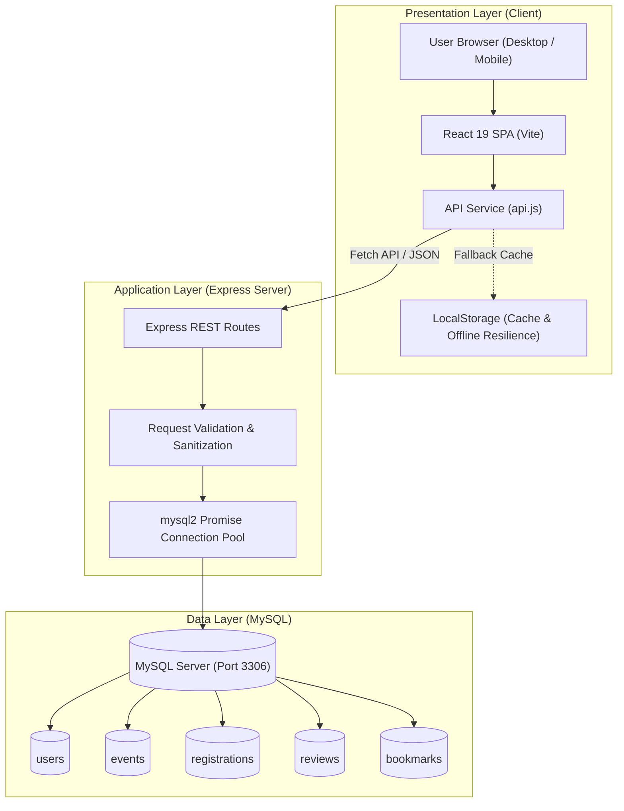
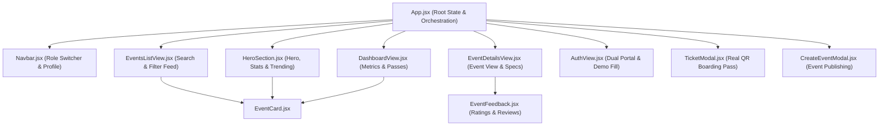
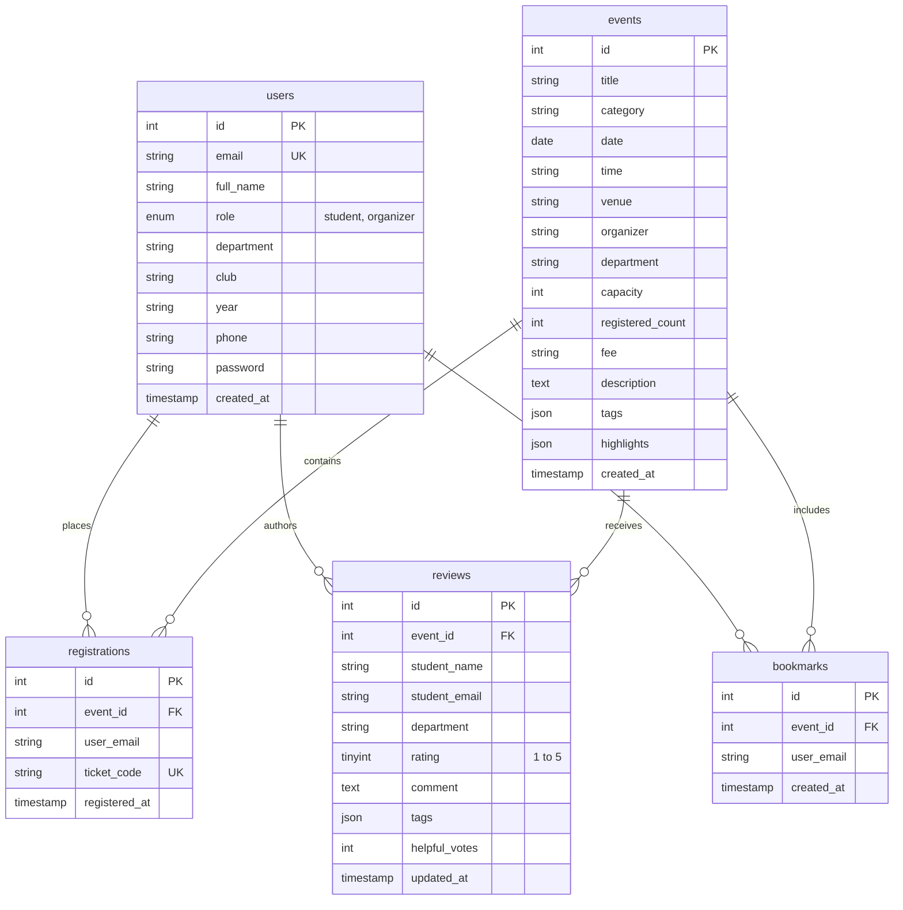

# 🏛️ Architecture & Technical Specification — Mira Events

This document details the architectural decisions, design patterns, database schema, and component structure powering the **Mira Events** campus management platform.

---

## 1. High-Level Architecture Overview

Mira Events follows a modern **three-tier client-server architecture**:
1. **Presentation Layer (Client):** Single Page Application (SPA) built with React 19, leveraging client-side state caching, optimistic UI updates, and responsive modular components.
2. **Application Layer (API Server):** Node.js runtime with Express framework providing RESTful JSON endpoints, business logic validation, and CORS security.
3. **Data Layer (Storage):** Relational MySQL database managed via a connection pool (`mysql2/promise`) with automatic schema initialization, constraint validation, and support for both local instances and managed cloud databases (Aiven, PlanetScale, DigitalOcean).

---

## 2. Component Hierarchy & Data Flow

The React frontend avoids monolithic design by segregating responsibilities into decoupled UI components:

### Component Responsibilities:

| Component | Responsibility |
| :--- | :--- |
| `App.jsx` | Holds global state (user, role, active page, toast messages), coordinates with the API service layer, and manages modal lifecycle. |
| `Navbar.jsx` | Fixed header with role toggle (Student/Organizer), registered passes count, and authentication controls. |
| `HeroSection.jsx` | Landing display with value proposition, live platform metrics strip, and top 3 trending upcoming events. |
| `EventsListView.jsx` | Interactive event directory with debounced search, category pills with count badges, and tabs (*Upcoming*, *Past*, *My Passes*). |
| `EventCard.jsx` | Card component displaying category-themed badges, title, organizer, formatted date, live capacity progress bar, rating, and quick actions. |
| `EventDetailsView.jsx` | Deep-dive page displaying event schedule, location, highlights, capacity status, and reviews. |
| `TicketModal.jsx` | Digital boarding pass rendering attendee information, perforated dividers, and a **real scannable SVG QR Code** powered by `qrcode.react`. |
| `EventFeedback.jsx` | Star rating summary, rating distribution bar charts (5★ down to 1★), student review submission form, and review feed. |
| `DashboardView.jsx` | Dual-mode dashboard displaying organizer analytics (Events, RSVPs, Avg Rating) or student pass cards. |
| `AuthView.jsx` | Split-view authentication portal with prefill demo credentials for instant evaluation. |

---

## 3. Database Entity-Relationship Diagram (ERD)

The relational schema ensures data integrity through foreign keys, cascaded deletions, and unique constraints.

---

## 4. REST API Endpoint Design

All endpoints follow RESTful conventions, returning standard JSON with appropriate HTTP status codes:

### Events Management
- `GET /api/events` — Returns an array of event objects sorted by date ascending.
- `POST /api/events` — Creates a new event record. Validates title, category, date, and venue. Returns `201 Created`.
- `DELETE /api/events/:id` — Deletes an event by ID. Associated registrations and reviews cascade.

### Registrations & Digital Passes
- `GET /api/registrations/:email` — Returns registered event IDs and ticket codes for the specified student.
- `POST /api/registrations` — Inserts a registration record and atomically increments `registered_count` on the event table. Returns `201 Created`.
- `DELETE /api/registrations/:eventId/:email` — Cancels an RSVP and decrements `registered_count`.

### Ratings & Feedback
- `GET /api/reviews` — Retrieves all reviews ordered by latest update.
- `POST /api/reviews` — Upserts a review using `ON DUPLICATE KEY UPDATE` on `(event_id, student_email)`. Enforces one review per student per event.

### Bookmarks
- `GET /api/bookmarks/:email` — Returns an array of bookmarked event IDs for the user.
- `POST /api/bookmarks/toggle` — Toggles bookmark state (inserts if absent, deletes if present).

---

## 5. Security & Reliability Considerations

1. **SQL Injection Prevention:** All SQL queries in `server/db.js` and `server/server.js` utilize **parameterized queries (`?` placeholders)** via `mysql2/promise`. No raw string concatenation is permitted.
2. **Graceful Offline Degradation:** If the MySQL database or backend server is temporarily paused during a demo, `src/services/api.js` catches fetch exceptions and falls back transparently to `localStorage`. The frontend continues functioning seamlessly.
3. **SSL / TLS Cloud Database Compatibility:** `server/db.js` includes automated SSL negotiation (`ssl: { rejectUnauthorized: false }`) enabling instant connection to managed cloud MySQL databases without certificate errors.
4. **CORS Hardening:** Express includes `cors()` middleware restricting and validating origins in production environments.

---

## 6. Scalability Strategy

- **Connection Pooling:** Instead of establishing a new TCP connection per request, a pool of reusable connections (`connectionLimit: 10`) handles concurrent transactions efficiently.
- **Database Indexing:** Key query paths (`registrations.user_email`, `registrations.event_id`, `reviews.event_id`) are indexed to maintain $O(\log n)$ lookup times even as event volume scales.
- **Static Asset Caching:** Built frontend files in `dist/` are hashed and optimized via Vite rollup bundling for CDN distribution (Vercel, Cloudflare, Netlify).
